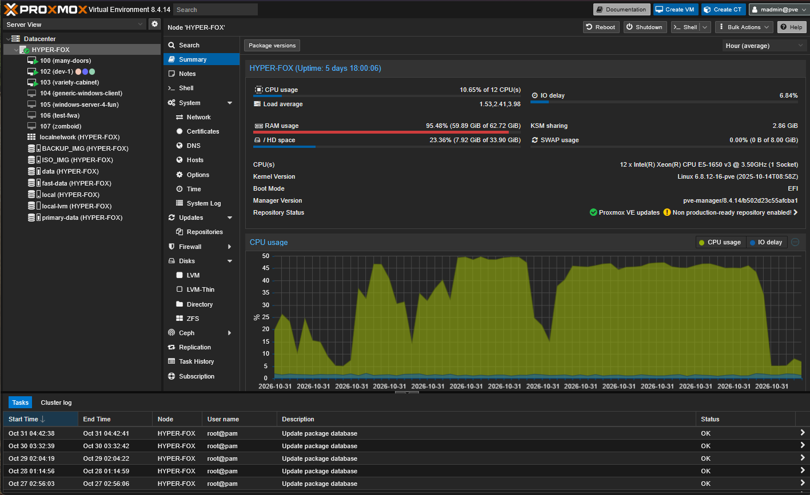

# Local Agentic AI with a Tesla P40
## A guide, with resources. No server rack, just an old Precision 5810.

## Dell Precision 56810

I found [this](https://i.dell.com/sites/csdocuments/Shared-Content_data-Sheets_Documents/en/al/CSG-EN-XX-ALL-Dell-Precision-Tower-5810-spec-sheet.pdf) bad boy during an office relocation giveaway, and you better believe I picked it up.
It's somewhere between a server and an office workstation in terms of hardware capabilities — being able to accept ECC RAM, support for up to 256GB of it, and having such a high PSU rating stock. I turned it into a server pretty quickly, and it was glorious.

